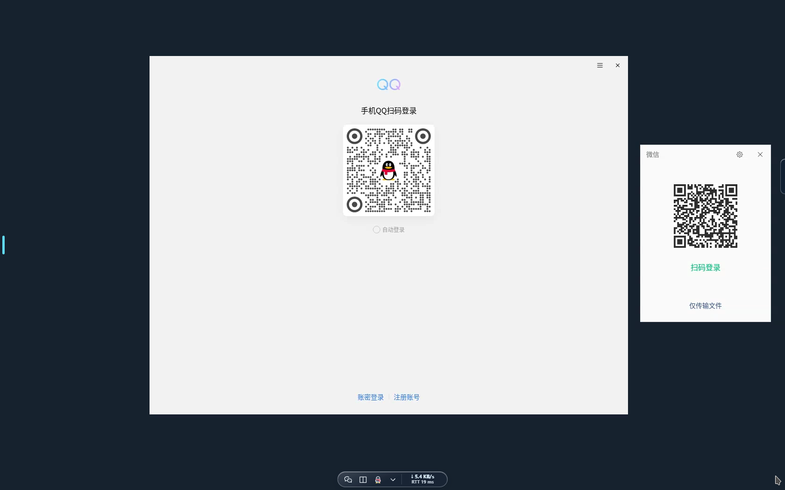
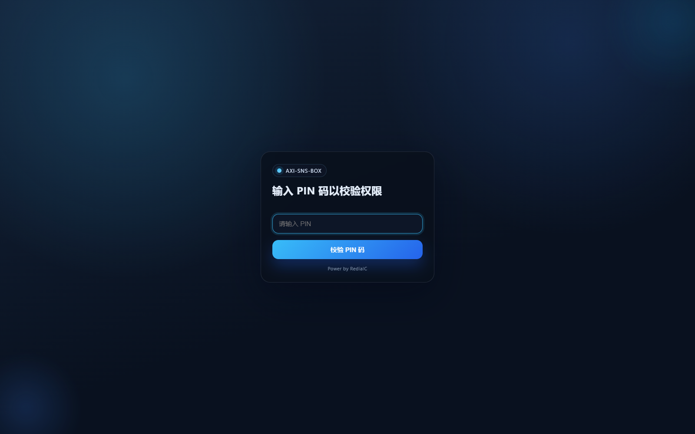
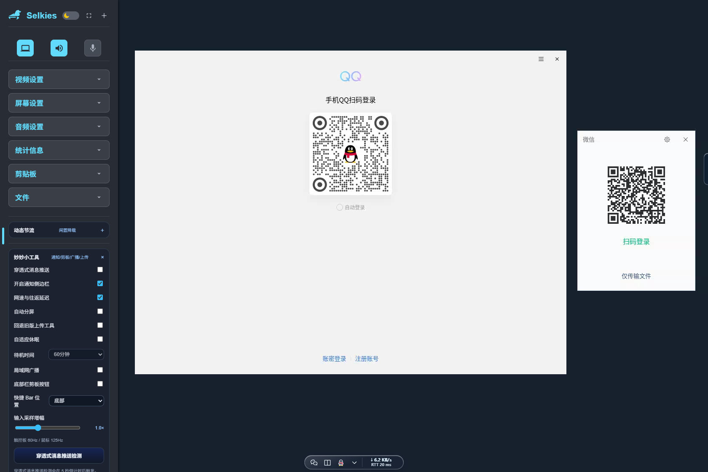

# WeChat Selkies AXiVer

基于 Docker 的微信 / QQ Linux 远程桌面镜像，通过 Selkies WebRTC 在浏览器中使用容器内的微信和 QQ。

当前维护分支：`AXiVer`。此前的 Intel 版本保存在 `_intel`，更早的备份保存在 `_AMDGPU`。

本分支使用 Mesa `radeonsi` 驱动，提供 H.264、H.265 和 AV1 推流。启动时自动选择 AMD 渲染节点并检查 H.264 编码能力；不可用时回退 CPU。AV1 单独检查所选设备和客户端能力，支持 X11 全帧、8-bit、4:2:0 硬件编码，失败时回退 H.264。源码版本及示例镜像标签为 `2.02`；硬件编码与客户端硬解的实际表现需在目标设备上验证。部署和编码支持见 [AMD 图形支持说明](docs/ops/amd-780m.md)及 [AV1 接入说明](docs/ops/av1-1.90.md)。

## 界面截图

2026-11-15 更新：以下为独立临时容器加载当前前端后的实拍截图，微信 / QQ 均未登录个人账号。

**桌面与快捷 Bar**



<details>
<summary>查看更多：PIN 登录与妙妙小工具</summary>

**PIN 登录**



**妙妙小工具**



</details>

## 主要功能

- 浏览器访问微信 / QQ，无需在本机安装客户端。
- 数据持久化到 `/config`，便于迁移和升级。
- 支持中文字体、本地输入、图片剪贴板、文件传输。
- 支持 AMD64 / ARM64 构建。
- 可选 `/dev/dri` 硬件编码，失败时自动回退 CPU。
- 自动启动微信，可选自动启动 QQ。
- 进程看门狗、X11 健康检查、QQ 卡死检测和自动拉起。

## AXiVer 新增功能

- **PIN 接管会话**：设置 `PASSWORD` 后，只有主动输入 PIN 的浏览器会成为唯一活动会话。刷新、睡眠唤醒、WebSocket 自动重连不会抢占当前会话。
- **旧会话强制回 PIN**：新的 PIN 登录成功后，旧 WebSocket 会被关闭并返回 PIN 页面，旧 Cookie 和旧 localStorage 不能绕过登录。
- **左侧侧边栏修复**：恢复 Selkies 原生左侧抽屉按钮，避免误把全屏按钮、分屏按钮或底部 Dock 按钮识别成侧边栏按钮。
- **快捷键**：`Alt + M` 打开 / 关闭左侧侧边栏。
- **视频软恢复优先**：遇到卡流、疑似画面乱块、解码异常时，先重建视频流和编码 pipeline；连续失败后才执行 X11 重修复。
- **底部快捷 Bar**：提供剪贴板、微信、QQ、分屏等常用入口，并支持折叠；收纳后只有三角按钮占用点击区域，其余位置可继续操作远程页面。
- **分屏工具**：支持左右分屏、上下分屏、全部全屏等布局。
- **自动分屏**：可在“妙妙小工具”中持久开启；每次从 PIN 进入或点击浮动 Bar 的分屏按钮时，宽高比超过 `4:3` 会直接左右分屏，低于 `3:4` 会直接上下分屏，阈值范围内（含边界）直接全部全屏；关闭此选项时，浮动 Bar 的分屏按钮仍会弹出布局菜单。
- **图片粘贴增强**：浏览器 `Ctrl + V` 可将图片写入远端剪贴板，并可自动粘贴到聊天输入框。
- **按需剪贴板同步**：不再监听本机剪贴板；`Ctrl+C` / `Ctrl+X` 会先让远端应用复制/剪切，再收取远端剪贴板，`Ctrl+V` 会先把本机剪贴板写入远端再粘贴。远端剪贴板若由应用自身发生变化，也会自动收剪板，并在底部活动提示中显示进度、成功、无变化或失败状态。
- **链接本地打开**：微信 / QQ 内点击链接时，浏览器侧显示确认卡片，可用本机浏览器打开并保留历史。
- **通知穿透**：微信 / QQ 的提醒可同步到浏览器 Notification、页面标题和底部按钮状态。
- **通知中心**：右侧可收纳通知中心集中显示微信、QQ、剪板、系统、工具和链接事件；推流流量总计保留在通知中心顶部摘要，实时网速与往返延迟移至快捷 Bar 左端，不再刷屏进入历史列表，同类系统级通知会在 1 分钟内合并为最新一条。
- **局域网发现广播**：可在侧边栏【妙妙小工具】中启用 mDNS 广播并设置广播名，供单窗口客户端优先发现局域网地址。
- **输入采样增幅**：可在侧边栏【妙妙小工具】中把指针与触摸输入的上报采样频率设为基准的 `0.5×～2×`（基准为触控板 60Hz、鼠标 125Hz），默认 `1×`；设置持久保存到 `/config/state`。
- **动态节流**：浏览器长时间无鼠标键盘交互后，可在低带宽、低帧率或低占用模式之间切换，降低客户端解码、渲染和 NAS 出站带宽压力；JPEG 直接限发送，H.264 会在进入 / 退出不活跃时重启采集以保持编码帧顺序。
- **静息优化与深度休眠**：普通静息保持微信 / QQ 收消息并减少后台开销。设置 `PASSWORD` 且启用 `SELKIES_CONTAINER_SLEEP=true` 后，达到待机时间会暂停桌面、应用、推流等工作进程，只保留登录页、鉴权、唤醒及必要监督服务；输入 PIN 后恢复。深度休眠期间不实时收消息。

## 近期更新

### 2.02

- 视频帧反馈与静态画质补绘（Paint-over）的选择会保存为视频偏好，刷新或重连后恢复；主屏和副屏分别保存。服务端能力和管理员限制仍优先。

### 2.01

- 侧边栏可实时切换 H.265 / AV1 静态画质补绘，支持跟随视频设置、开启或关闭，无需刷新页面或重建采集。界面区分所选模式与当前实际状态；H.264 和旧服务端暂不提供此热切换。

### 2.00

- 增加视频帧反馈，可选关闭、仅观测或自适应帧率；主控可在侧边栏切换，默认关闭。反馈分别观察接收、解码和绘制进度，并在受支持的 H.265 / AV1 会话中按持续积压调整帧率；H.264 最多提供观测。
- 完善流状态、背压和编码诊断，并加固中文输入和剪贴板传输。使用条件与验证范围见 [视频帧反馈说明](docs/ops/frame-feedback.md)；实际硬件、网络与客户端收益仍需在目标环境测量。

### 更早的更新

- **1.90–1.93**：加入 AV1 推流与能力检查，改进画面冻结检测、解码恢复和连接状态提示。详见 [AV1 接入](docs/ops/av1-1.90.md)、[AV1 验收](docs/ops/av1-validation.md)和 [画面恢复](docs/ops/stream-health-1.93.md)。
- **1.86–1.89**：增加 H.265 推流及视频设置持久化，完善输入法恢复与小工具分组。详见 [中文输入修复](docs/ops/ime-recovery-1.88.md)。
- **1.80–1.85**：完善动态节流、深度休眠、中文输入和剪贴板可靠性，并加入 AMD 图形支持。详见 [节流设置](docs/ops/throttle-preferences-1.83.md)及 [输入与剪贴板加固](docs/ops/input-clipboard-environment-hardening.md)。
- **更早版本**：逐步加入会话接管、文件传输、通知、分屏和界面改进；具体变更可查阅 Git 历史及 `docs/`。

## 快速开始

### 构建 AMD 镜像

当前 AMD 适配需要从源码构建，旧 Intel 离线包不包含这些改动。在仓库目录执行：

```bash
docker build -t wechat-selkies:2.02 .
```

启动：

```bash
docker run -d \
  --name wechat-selkies \
  -p 3000:3000 \
  -p 3001:3001 \
  -v ./config:/config \
  --device /dev/dri:/dev/dri \
  -e PASSWORD=1234 \
  --shm-size=1g \
  --restart unless-stopped \
  wechat-selkies:2.02
```

访问：

- HTTP：`http://localhost:3000`
- HTTPS：`https://localhost:3001`

### 使用 docker compose

仓库已包含 `docker-compose.yml`，调整环境变量后构建并启动：

```bash
docker compose up -d --build
```

仓库内的 Compose 配置会同时启动 `axisnsbox-discovery` 发现 sidecar。该 sidecar 使用 host 网络发布 mDNS，业务容器仍保持 bridge 网络。

常用配置示例：

```yaml
services:
  wechat-selkies:
    image: wechat-selkies:2.02
    container_name: wechat-selkies
    init: true
    ports:
      - "3000:3000"
      - "3001:3001"
    volumes:
      - ./config:/config
    devices:
      - /dev/dri:/dev/dri
    environment:
      - PUID=1000
      - PGID=100
      - TZ=Asia/Shanghai
      - PASSWORD=1234
      - AUTO_START_WECHAT=true
      - AUTO_START_QQ=false
      - SELKIES_SESSION_MODE=pin-takeover
      - CUSTOM_WS_PORT=8081
      - WATCHDOG_AUDIO=true
      - SELKIES_VIDEO_CORRUPTION_WATCHDOG=false
      - SELKIES_ENCODER=x264enc,h265enc,av1enc,x264enc-striped,jpeg
      - SELKIES_DEFAULT_ENCODER=x264enc
      - SELKIES_DISABLE_GAMEPAD=true
      - SELKIES_DYNAMIC_THROTTLE=true
      - SELKIES_DYNAMIC_THROTTLE_MODE=idle-low-occupancy
      - SELKIES_DYNAMIC_LOW_LATENCY_FPS=2
      - SELKIES_DYNAMIC_LOW_LATENCY_HOLD_MS=15000
      - SELKIES_ADAPTIVE_SLEEP_IDLE_SECONDS=3600
      - SELKIES_ADAPTIVE_SLEEP_CHECK_SECONDS=5
    mem_reservation: "2g"
    mem_limit: "8g"
    shm_size: "2gb"
    restart: unless-stopped
```

## 重要配置

| 变量名 | 默认值 | 说明 |
| --- | --- | --- |
| `PASSWORD` | 空 | PIN 登录密码；为空时保持无 PIN 兼容模式 |
| `CUSTOM_USER` | 空 | 旧配置兼容字段，PIN 模式下不需要填写 |
| `PUID` | `1000` | 容器用户 ID |
| `PGID` | `100` | 容器用户组 ID |
| `TZ` | `Asia/Shanghai` | 时区 |
| `SELKIES_HTTP_PORT` | `3000` | Compose 发布到宿主机的 HTTP 端口 |
| `SELKIES_HTTPS_PORT` | `3001` | Compose 发布到宿主机的 HTTPS 端口，也是默认广播端口 |
| `SELKIES_LAN_DISCOVERY_DEFAULT_ENABLED` | `false` | 首次运行且尚无持久化设置时是否默认开启局域网广播 |
| `SELKIES_LAN_DISCOVERY_DEFAULT_NAME` | `AXISNSBOX-000` | 首次运行的默认广播名 |
| `SELKIES_LAN_ADVERTISE_ADDRESS` | 自动检测 | 多网卡宿主机可显式指定需要广播的局域网 IPv4 地址 |
| `AUTO_START_WECHAT` | `true` | 自动启动微信 |
| `AUTO_START_QQ` | `false` | 自动启动 QQ |
| `PROCESS_WATCHDOG` | `true` | 启用进程看门狗 |
| `WATCHDOG_INTERVAL` | `10` | 看门狗检查间隔，单位秒 |
| `WATCHDOG_TRAY` | `false` | 是否自动拉起托盘进程 |
| `WATCHDOG_RESTART_WECHAT` | `true` | 微信退出后自动重启 |
| `WATCHDOG_RESTART_QQ` | `true` | QQ 退出后自动重启 |
| `X11_WATCHDOG` | `true` | 启用 X11 健康检查 |
| `X11_WATCHDOG_FAIL_THRESHOLD` | `6` | X11 连续失败后触发恢复的阈值 |
| `SELKIES_SESSION_MODE` | `pin-takeover` | PIN 接管会话模式 |
| `SELKIES_SESSION_STATE_PATH` | `/run/selkies-active-session.json` | 当前活动会话状态文件 |
| `SELKIES_SESSION_AUTH_PORT` | `38082` | 会话校验桥接服务端口 |
| `SELKIES_VIDEO_CORRUPTION_WATCHDOG` | `false` | 启用视频乱块 / 卡流 watchdog；默认关闭，避免推流恢复通知打扰 |
| `SELKIES_VIDEO_SOFT_RECOVER_LIMIT` | `2` | 软恢复失败次数超过后才重修复 X11 |
| `SELKIES_VIDEO_RECOVER_COOLDOWN_MS` | `120000` | 视频恢复冷却时间 |
| `SELKIES_ENABLE_BINARY_CLIPBOARD` | `true` | 启用二进制剪贴板 |
| `SELKIES_PASTE_IMAGE` | `true` | 启用图片粘贴 |
| `SELKIES_PASTE_IMAGE_MAX_SIZE` | `20971520` | 图片粘贴大小上限 |
| `SELKIES_PASTE_IMAGE_AUTO_PASTE` | `true` | 写入远端剪贴板后自动 Ctrl+V |
| `SELKIES_XTEST_INPUT` | `true` | 已映射按键（回车、退格、空格等）通过 XTEST 注入；不影响中文整段提交；设为 `false` 回退旧按键路径 |
| `SELKIES_IME_PASTE_SHORTCUT` | `ctrl+v` | X11 中文提交使用的粘贴键，另支持 `ctrl+shift+v`、`shift+Insert` |
| `SELKIES_CLIPBOARD_DIAGNOSTICS` | `false` | 临时记录每次剪贴板格式列表；默认只记录格式变化，不记录内容 |
| `PERSIST_SYSTEM_IDENTITY` | `true` | 将容器系统标识保存在 `/config/.system-identity`，首次升级迁移说明见加固文档 |
| `WECHAT_PROXY_MODE` | `direct` | 微信启动时清除代理环境变量；`inherit` 保留环境代理，不控制 TUN/VPN/路由器 |
| `SELKIES_INPUT_QUEUE` | `true` | 每连接一条有序队列处理按键、剪贴板和 IO 重置，接收循环继续处理帧确认，避免打字期间画面暂停；设为 `false` 恢复串行处理 |
| `SELKIES_INPUT_QUEUE_MAX` | `256` | 输入积压告警水位（16–4096），超过后继续保序处理帧确认；合并相邻无按键鼠标移动，硬上限为 `max(4096, 水位×4)`，达到硬上限时关闭该过载连接，避免无限积压或静默丢弃按键 |
| `SELKIES_ENCODER` | `x264enc,h265enc,av1enc,x264enc-striped,jpeg` | 允许编码器列表；AV1 还须通过服务端 GPU 与客户端能力探测 |
| `SELKIES_DEFAULT_ENCODER` | `x264enc` | 默认编码器；`x264enc` 优先 VAAPI，`x264enc-striped` 为 CPU 分片模式 |
| `SELKIES_DEFAULT_FRAMERATE` | `30` | 默认推流帧率 |
| `SELKIES_DEFAULT_USE_CPU` | `false` | 优先尝试硬件编码，失败时回退 CPU |
| `SELKIES_DEFAULT_H264_STREAMING_MODE` | `true` | 默认开启 H264 streaming mode |
| `SELKIES_DEFAULT_H264_CRF` | `30` | 默认 H264 CRF |
| `SELKIES_DYNAMIC_THROTTLE` | `true` | 启用动态节流；`SELKIES_DYNAMIC_LOW_LATENCY` 仍作为兼容别名 |
| `SELKIES_DYNAMIC_THROTTLE_MODE` | `idle-low-occupancy` | 动态节流模式：`idle-low-bandwidth`、`idle-low-framerate` 或 `idle-low-occupancy` |
| `SELKIES_DYNAMIC_LOW_LATENCY_HOLD_MS` | `15000` | 最后一次交互后多久进入动态节流 |
| `SELKIES_DYNAMIC_LOW_LATENCY_FPS` | `2` | 低帧率模式发送帧率上限，可设置为 `1` 到 `120`；已有浏览器设置优先 |
| `SELKIES_DYNAMIC_LOW_LATENCY_H264_CRF` | `35` | 低带宽侧的 H264 CRF 默认值 |
| `SELKIES_DYNAMIC_LOW_LATENCY_SAMPLE_PERCENT` | `87` | 低带宽采样 / 带宽缩放下限 |
| `SELKIES_ADAPTIVE_SLEEP_IDLE_SECONDS` | `3600` | 自适应休眠默认待机秒数；界面可选 `60`、`900`、`1800`、`2700`、`3600` |
| `SELKIES_ADAPTIVE_SLEEP_CHECK_SECONDS` | `5` | 自适应休眠检查间隔 |
| `SELKIES_AUTO_SPLIT` | `false` | 自动分屏首次默认值；超过 `4:3` / `3:4` 阈值时分屏，阈值内全部全屏；界面修改后写入 `/config/state/notification-bridge.json` 持久保存 |
| `SELKIES_CONTAINER_SLEEP` | `false` | 启用 PIN 驱动的深度休眠，暂停微信 / QQ 等工作进程；compose 示例中已开启，但只有设置 `PASSWORD` 后才会实际生效 |
| `SELKIES_HIDDEN_STREAM_IDLE_SECONDS` | `60` | 所有页面隐藏后停止音视频采集的等待秒数；页面可见时恢复。`0` 禁用此快捷策略，回到自适应休眠设置 |
| `SELKIES_CONTAINER_SLEEP_IDLE_SECONDS` | `180` | 旧版兜底值；启用自适应休眠后以界面选择的待机时间为准 |
| `SELKIES_CONTAINER_SLEEP_STARTUP_GRACE_SECONDS` | `180` | 容器启动后多久以内不进入内部休眠，避免刚启动就睡眠 |
| `SELKIES_STREAM_WAIT_THRESHOLD_MS` | `35000` | 长时间等待视频流时触发恢复 |
| `SELKIES_STREAM_RECOVER_COOLDOWN_MS` | `120000` | 页面级恢复冷却时间 |
| `SELKIES_STREAM_REBUILD_MAX_MS` | `24000` | 「正在重建视频流」提示的硬超时，到点强制收尾，防止卡在重建状态 |
| `SELKIES_STREAM_RECOVER_HARD_STAGES` | `2` | 轻量恢复失败后继续尝试的就地管线重启次数（不刷新页面） |
| `SELKIES_PAGE_STALL_RELOAD_MIN_RECOVERS` | `2` | 允许整页重置前必须先失败的就地恢复次数 |
| `SELKIES_FULL_RESET_GRACE_MS` | `9000` | 整页重置预约后的宽限期，期间恢复则自动取消 |
| `SELKIES_RECOVER_LADDER_RESET_MS` | `120000` | 推流持续健康多久后把恢复阶梯归零 |
| `SELKIES_LOCAL_LINK_OPEN` | `true` | 启用链接本地打开确认 |
| `LOCAL_LINK_BRIDGE_PORT` | `38080` | 本地链接桥接端口 |
| `LOCAL_LINK_BRIDGE_ALLOWED_SCHEMES` | `http,https,mailto` | 允许处理的链接协议 |
| `DRI_NODE` | `auto` | 自动选择通过 H.264 编码能力探测的 AMD 渲染节点；可指定 `/dev/dri/renderD128` 等实际路径 |
| `LIBVA_DRIVER_NAME` | `radeonsi` | AMD 使用 Mesa；启动探测成功后也会覆盖迁移配置残留的 `iHD` / `i965`。旧 `INTEL_VAAPI_DRIVER` 不再使用 |
| `QQ_EXTRA_FLAGS` | 见 `docker-compose.yml` | QQ 启动附加参数 |
| `QQ_NICE_LEVEL` | `-2` | QQ 进程优先级 |
| `QQ_WATCHDOG_HANG_DETECT` | `true` | 启用 QQ 卡死检测 |
| `QQ_WATCHDOG_FAIL_THRESHOLD` | `3` | QQ 连续检测失败后重启 |

## 独立文件上传（1.57）

选择或拖放文件后，桥接层会阻止文件进入旧 WebSocket 链路，自动在当前页面打开 `/uploader/` 浮窗并交给新上传模块处理。浮窗关闭只会隐藏并保留 iframe、Worker 和队列，之后可通过侧边栏的“上传文件”按钮重新打开；关闭回退时该按钮使用独立上传面板，开启回退时则交给 Selkies 原生上传链路。默认 512KiB 分片用于兼容常见外网代理的 1MiB 请求体限制，同时保留 `SELKIES_UPLOAD_CHUNK_SIZE` 覆盖能力。每个分片 PUT 有 45 秒超时，并按网络异常、408/425/429/5xx 等分类退避重试；最终失败会提示检查外网代理或启用【回退旧版上传工具】。Worker 会发送有界、去除 token 的 attempt/success/failure/retry 诊断。文件读取、分片、重试和速度统计运行在 Dedicated Worker 中，分片通过独立 HTTP sidecar 发送，不再进入 Selkies 主数据 WebSocket；刷新后需要重新选择同名、同大小文件以恢复本地 `File` 引用。若 PIN/session epoch 被其他客户端接管，旧任务会停止并发分片、废弃旧 session 后刷新 token 自动重建，连续接管达到上限时会给出明确提示。

| 变量 | 默认值 | 说明 |
| --- | --- | --- |
| `SELKIES_UPLOAD_ENABLED` | `true` | 启用独立上传 sidecar，并自动接管原文件上传操作 |
| `SELKIES_UPLOAD_DIR` | `/config/uploads` | 上传根目录及 `.staging` 所在目录 |
| `SELKIES_DOWNLOAD_ROOT` | `/config` | 下载文件浏览根目录；默认仅浏览 `/config`，自定义绝对路径仍可用；`FILE_MANAGER_PATH` 仍用于旧版上传 |
| `SELKIES_DROP_DOWNLOAD_ENABLED` | `true` | 从容器桌面拖文件到快捷 Bar 后下载；同时遵守 `SELKIES_FILE_TRANSFERS` 的 download 开关和 `HARDEN_DESKTOP` |
| `SELKIES_DROP_SOURCE_ROOTS` | 自动识别常用目录及微信/QQ附件目录 | 未设置时包含 `/config/{Desktop,Downloads,Documents,uploads,xwechat_files}`，并动态识别 `/config/.config/QQ/nt_qq_*/nt_data` 等布局下的 `File/Pic/Video/Ptt/Emoji` 附件子目录；显式设置时仅使用指定的冒号分隔目录，不读取整个 QQ 账号配置目录 |
| `SELKIES_DROP_CACHE` | `/run/selkies-drop-cache` | 私有临时缓存，必须位于 `SELKIES_DOWNLOAD_ROOT` 外；重启时清除旧缓存，不可映射为 nginx 静态目录 |
| `SELKIES_DROP_MAX_FILE_BYTES` | `2147483648` | 单文件上限 2 GiB；每次仅接收一个普通文件 |
| `SELKIES_DROP_MAX_CACHE_BYTES` | `4294967296` | 缓存总量上限 4 GiB，包含复制中的预留容量 |
| `SELKIES_DROP_MAX_JOBS` | `4` | 活动任务与待清理任务总数上限；同一时间仅准备一个文件 |
| `SELKIES_DROP_MIN_FREE_BYTES` | `268435456` | 复制后至少保留 256 MiB 空间 |
| `SELKIES_DROP_TTL_SECONDS` | `300` | 就绪凭证有效 300 秒；传输完成后 15 秒清理，活动响应不被 TTL 清理 |
| `SELKIES_DROP_PREPARE_TIMEOUT_SECONDS` | `3600` | 文件准备最长 1 小时；就绪后才开始计算下载凭证 TTL |

容器文件拖到快捷 Bar 的发光区域后松开，会准备临时副本并由当前浏览器下载，不打开 `/files/`。文件应来自支持 X11 XDND `text/uri-list` 的应用；微信/QQ 若仅提供应用内部消息、网页 URL 或没有文件 URI，无法直接下载，请先将附件保存到上表的来源目录再拖动。目录、文本和多文件同时拖动会被拒绝。提示“下载已触发”表示浏览器请求已经启动，最终保存位置和下载许可由浏览器控制。

自定义缓存必须是专用目录；已有目录只允许包含本功能标记与随机命名的缓存文件，不能使用 `/tmp`、`/run` 等共享目录。禁用此功能可设 `SELKIES_DROP_DOWNLOAD_ENABLED=false`；回滚只需恢复此前镜像，不影响源文件及普通下载目录。
| `SELKIES_UPLOAD_MAX_FILE_SIZE` | `2147483648` | 单文件最大字节数 |
| `SELKIES_UPLOAD_CHUNK_SIZE` | `524288` | HTTP 分片大小，范围 64 KiB–64 MiB；可按外网代理限制覆盖 |
| `SELKIES_UPLOAD_MAX_CONCURRENCY` | `3` | sidecar 同时接收的最大分片数 |
| `SELKIES_UPLOAD_TOKEN_TTL_SECONDS` | `300` | 上传 token 有效期 |
| `SELKIES_UPLOAD_RESUME_ENABLED` | `true` | 允许从 `.staging` 元数据恢复 |
| `SELKIES_UPLOAD_CHECKSUM_ENABLED` | `true` | 允许 BLAKE3/SHA-256 完成校验 |
| `SELKIES_UPLOAD_ALLOW_OVERWRITE` | `false` | token 是否允许覆盖已存在文件 |
| `SELKIES_UPLOAD_MIN_FREE_BYTES` | `268435456` | 上传开始后必须保留的磁盘空间 |
| `SELKIES_UPLOAD_ALLOWED_SUBDIRS` | 空 | 可选的逗号分隔目标子目录白名单 |
| `SELKIES_LEGACY_UPLOAD_ENABLED` | `false` | 启用旧 WebSocket 上传兼容包装 |
| `SELKIES_UPLOAD_DIAGNOSTICS_MAX_BYTES` | `524288` | `upload-diagnostics.jsonl` 单文件上限（512 KiB），超出即滚动 |
| `SELKIES_UPLOAD_DIAGNOSTICS_ARCHIVES` | `3` | 保留的滚动归档份数（`.1` / `.2` / `.3`） |
| `SELKIES_UPLOAD_DIAGNOSTICS_KEEP_SAMPLES` | `false` | 是否保留周期性 `*-sample` 心跳采样；默认丢弃以避免日志膨胀 |
| `SELKIES_UPLOAD_DIAGNOSTICS_RETENTION_DAYS` | `7` | 按天归档的保留天数 |

下载目录由 nginx 的 `abc` 用户读取，以便访问微信私有目录；`ssl` 和根级隐藏目录不会通过下载入口暴露，访问下载仍必须通过 PIN 鉴权。

“妙妙小工具”中的“回退旧版上传工具”开关默认关闭并持久化到当前页面。开启后，桥接层不会阻止 `change`/拖放/侧边栏“上传文件”请求，文件继续走 Selkies 原生 WebSocket 上传；关闭后，侧边栏“上传文件”按钮打开当前页面的独立上传面板。同时按需安装旧链路的读取 backpressure 和传输队列包装。

## 局域网发现广播（1.48）

- 打开左侧侧边栏的【妙妙小工具】，启用“局域网广播”后即可编辑广播名。
- 广播名默认为 `AXISNSBOX-000`，允许 1–32 位英文字母、数字、下划线和连字符；保存时会转成大写。
- 服务以 `_axisnsbox._tcp.local` 类型发布，端口为 `SELKIES_HTTPS_PORT`，配置变化通常会在约 1 秒内生效。
- 客户端发现候选地址后，应请求 `/.well-known/axisnsbox` 验证 `service` 是否为 `wechat-selkies`，再跳转到返回的 HTTPS 端口。
- `axisnsbox-discovery` 使用 `network_mode: host`，主要面向 Linux/NAS 宿主机；如果防火墙阻止 UDP 5353 或局域网禁用了组播，mDNS 将不可见。多网卡环境可给 sidecar 设置 `SELKIES_LAN_ADVERTISE_ADDRESS`。
- 广播开关和名称持久化在 `./config/state/notification-bridge.json`，升级或重启容器后会保留。

若不使用 Compose，业务容器启动后还需要用同一个镜像启动发现 sidecar：

```bash
docker run -d \
  --name axisnsbox-discovery \
  --network host \
  -v ./config:/config \
  --entrypoint python3 \
  --restart unless-stopped \
  wechat-selkies:2.02 \
  -u /scripts/lan_discovery_service.py
```

诊断日志位于 `/config/logs/upload-sidecar.log` 和 `/config/logs/upload-diagnostics.jsonl`。浏览器端仅记录异常事件(长任务、连接关闭、页面重载、上传失败等)，`*-sample` 周期心跳采样默认丢弃(`SELKIES_UPLOAD_DIAGNOSTICS_KEEP_SAMPLES=true` 可恢复)；`upload-diagnostics.jsonl` 单文件上限 512 KiB，超出即滚动为 `.1` / `.2` / `.3`(`SELKIES_UPLOAD_DIAGNOSTICS_MAX_BYTES` / `..._ARCHIVES`)，同时按天归档为 `upload-diagnostics.jsonl.YYYYMMDD`，默认保留最近 7 天(`SELKIES_UPLOAD_DIAGNOSTICS_RETENTION_DAYS`)。详细安全边界、API 与迁移说明见 `docs/upload-architecture-1.45.md`。

## 会话规则

设置 `PASSWORD` 后：

- 第一次输入 PIN 的浏览器成为当前活动会话。
- 当前活动会话刷新页面可以继续使用，不需要重新输入 PIN。
- 旧电脑、睡眠唤醒电脑、旧浏览器标签页自动重连时，不会抢占当前活动会话，会返回 PIN 页面。
- 另一台电脑主动输入 PIN 后，会成为新的活动会话，旧会话被踢回 PIN 页面。

未设置 `PASSWORD` 时，保持无 PIN 的兼容行为。

## 视频恢复策略

视频异常时按分级阶梯自动恢复，原则是**先就地重建、非必要不整页刷新**：

1. **轻量重建**：清理客户端解码状态并触发 Selkies 流恢复事件（`RESET_IO_MODULES` + `FORCE_STREAM_RECOVER`），不动页面生命周期。
2. **就地重启管线**：轻量重建无效后，就地执行 `STOP_VIDEO` / `STOP_AUDIO` → `RESET_IO_MODULES` → `FORCE_STREAM_RECOVER` → `START_VIDEO` / `START_AUDIO`，保留 WebSocket 会话、剪贴板与 UI 状态，**不刷新页面**。
3. **提示人工**：阶梯走完后给出提示，等待手动点击侧边栏的“重修复推流与 X11”。
4. **整页重置（最后手段）**：仅在卡顿超过 `SELKIES_PAGE_STALL_RELOAD_THRESHOLD_MS` 且已失败至少 `SELKIES_PAGE_STALL_RELOAD_MIN_RECOVERS` 次就地恢复后才考虑；即便如此也只是**预约**刷新，并留 `SELKIES_FULL_RESET_GRACE_MS` 宽限期，画面在宽限期内恢复会自动取消刷新。

配套的防卡死措施：

- 任何“正在重建视频流 / 正在重启推流系统”提示都有 `SELKIES_STREAM_REBUILD_MAX_MS` 硬超时，到点强制收尾并复位恢复状态，不会长期挂在页面上。
- 帧恢复更新、视频管线恢复、推流恢复成功都会立即关闭重建提示并取消已预约的整页刷新。
- 等待状态检测会排除页面自身注入的活动横幅等层，避免把提示文案本身误判成“等待视频流”而导致自锁。
- 推流持续健康 `SELKIES_RECOVER_LADDER_RESET_MS` 后，恢复阶梯归零，下次故障重新获得完整的自动重建次数。

所有恢复动作都有冷却时间，避免循环重启影响微信 / QQ 窗口。页面中仍保留手动按钮“重修复推流与 X11”。

## 通知中心

- 右侧通知中心集中收纳微信、QQ、剪板、系统、工具、客户端和链接事件，并保留顶部未读/历史数量。
- 顶部带宽摘要仍显示当前推流上传/下载速率和 24 小时估算流量，但“今日推流流量统计”不会再进入通知历史。
- 剪板、系统、工具、音频、客户端、链接等同类抬头通知会在 1 分钟内合并为最新信息，倒计时以最后一条出现时间重新计算。
- 收纳按钮位于右侧上方三分之一处，列表滚动条与通知中心深色界面保持统一。

## 动态节流与自适应休眠

- 动态节流用于“网页还开着但暂时不操作”的场景。它可选择低带宽、低帧率或低占用模式，主要降低浏览器解码 / 渲染负载和 NAS 出站带宽。
- 动态节流对 JPEG 使用发送端节流；对 H.264 会在进入 / 退出不活跃时重启采集应用低帧率配置，避免丢弃依赖帧导致坏块或解码器回退。
- 自适应休眠按所有客户端的键鼠交互判断，可选择 1、15、30、45、60 分钟待机时间。
- 达到待机时间后会推送 60 秒全屏逐渐变暗的确认遮罩；鼠标点击或任意按键会解除遮罩并重置倒计时。
- 警告后超过 60 秒仍无交互时，`SELKIES_CONTAINER_SLEEP=true` 会进入深度休眠，以 `SIGSTOP` 暂停微信 / QQ / 桌面 / 推流等工作进程，只保留登录页、鉴权、唤醒及必要监督服务。输入 PIN 后以 `SIGCONT` 恢复。页面隐藏 60 秒后的采集暂停是另一项普通静息优化，不提前进入深度休眠。
- PIN 页面只有在容器确实休眠时才会在背景显示“容器等待唤醒”。
- 深度休眠期间微信 / QQ 暂停，不实时收消息；普通静息仍正常收消息。暂停进程保留内存以便快速恢复，不等于释放全部内存。只在停止采集时释放 Selkies 的闲置资源，不强制清理宿主机缓存。

## 侧边栏和快捷键

- 左侧窄条按钮是 Selkies 原生侧边栏抽屉按钮。
- `Alt + M` 可以打开 / 关闭左侧侧边栏。
- 全屏、分屏、剪贴板、微信、QQ 和底部 Dock 按钮不会被强行移动到左侧。

## 构建

本地构建：

```bash
docker build -t wechat-selkies:2.02 .
```

构建依赖两个构建参数，普通 `docker build` 已内置默认值，用 BuildKit / buildx 时会自动注入真实平台：

- `TARGETPLATFORM` / `BUILDPLATFORM`：默认 `linux/amd64`。
- `QQ_LOCAL_URL`：可选，指定 QQ `.deb` 的下载镜像地址，覆盖官方 CDN。
- `RUNTIME_BASE`：默认 `app-base`（完整构建）。本机已有同架构的 `wechat-selkies:1.84` 时，可用 `docker build --build-arg RUNTIME_BASE=wechat-selkies:1.84 -t wechat-selkies:2.02 .` 复用微信 / QQ 安装层，安装 AMD Mesa 驱动并构建当前源码覆盖层和上传组件。

如果构建时 QQ 下载报 `curl: (22) ... error: 403`，说明官方 CDN 拒绝了自动化下载，此时用任意可达地址替代即可（内网镜像、对象存储，或本机临时 HTTP 服务）：

```bash
# 例：从 1.59 镜像导出 QQ 包并起一个临时 HTTP 源
docker run --rm -v "$PWD/vendor:/out" --entrypoint bash wechat-selkies:1.59 -c '
  mkdir -p /tmp/b/DEBIAN /tmp/b/opt && cp -a /opt/QQ /tmp/b/opt/ &&
  sed -n "/^Package: linuxqq$/,/^$/p" /var/lib/dpkg/status | grep -vE "^(Status|Installed-Size)" > /tmp/b/DEBIAN/control &&
  for s in preinst postinst prerm postrm; do [ -f /var/lib/dpkg/info/linuxqq.$s ] && cp /var/lib/dpkg/info/linuxqq.$s /tmp/b/DEBIAN/$s; done &&
  dpkg-deb -Zgzip --build /tmp/b /out/linuxqq.deb'

python3 -m http.server 8899 --directory vendor &
docker build --build-arg QQ_LOCAL_URL="http://host.docker.internal:8899/linuxqq.deb" -t wechat-selkies:2.02 .
```

导出镜像：

```bash
docker save -o wechat-selkies-2.02.tar wechat-selkies:2.02
```

仓库根目录的 `.dockerignore` 采用白名单，只放行 `Dockerfile`、`root/` 和 `upload-sidecar/`，避免把 Release 的 `.tar` 包和客户端构建产物传进构建上下文。

## 故障排查

查看日志：

```bash
docker compose logs -f wechat-selkies
```

常见处理：

- 无法访问页面：确认端口 `3000` / `3001` 未被占用，并检查容器是否运行。
- 升级后菜单或窗口行为异常：可清空挂载目录下的 Openbox 配置，例如 `./config/.config/openbox`。
- 图片粘贴不可用：需要 HTTPS 或 localhost，并确认浏览器允许剪贴板权限。
- 硬件编码异常：确认宿主机存在 `/dev/dri/renderD128`，或临时设置 `SELKIES_DEFAULT_USE_CPU=true`。
- 画面持续异常：先使用页面内恢复按钮；如果频繁发生，查看 `/config/logs` 下的 watchdog 和 Selkies 日志。

## 目录结构

```text
wechat-selkies/
├── docker-compose.yml
├── Dockerfile
├── LICENSE
├── README.md
├── docs/
├── scripts/
└── root/
    ├── defaults/
    ├── etc/
    ├── scripts/
    └── usr/share/selkies/selkies-dashboard/
```

## 说明

本项目与腾讯公司无关联。微信和 QQ 的商标、名称及客户端版权归腾讯公司所有。本项目仅用于个人学习、研究和自用部署，使用者应自行遵守相关服务条款和当地法律法规。

## 相关链接

- [Selkies WebRTC](https://github.com/selkies-project)
- [LinuxServer.io baseimage-selkies](https://github.com/linuxserver/docker-baseimage-selkies)
- [微信 Linux](https://linux.weixin.qq.com/)
