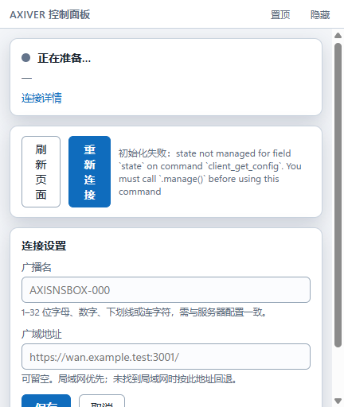

# 单窗口与液态玻璃整合分析

日期：2026-10-25。范围：当前 SNSBox / AXIVER Windows 客户端。

## 结论

建议将日常使用收敛到一个原生主窗口：远程桌面为主要内容，本地连接状态、连接设置和下载结果成为窗口内部的控制层。当前三个窗口的结构满足了本地/远端权限分离，但把实现边界直接变成了用户需要管理的三个界面。

单窗口整合与液态玻璃换肤已实施，当前实现与验证见 [design-qa-v3.md](./design-qa-v3.md)。以下保留改造前分析；最终采用可拖动状态胶囊与同窗口浮卡，松手 10 秒后自动归位，替代原分析中的常驻顶部控制栏。

## 本次可观察的现状

本次通过独立副本、临时 SQLite 与全新 WebView2 profile 捕获本地面板，不读取用户登录态。

| 步骤 | 当前行为 | 判断 |
|---|---|---|
| 1. 启动 | `main.rs` 建立远程窗口、本地面板及状态胶囊，随后主动显示面板并获取焦点 | 主任务与配置任务竞争注意力；正常连接时不应强制展示设置 |
| 2. 查看状态 | 远程页面上叠放另一个 owned window；点击后打开独立控制面板 | 入口可发现，但独立浮窗仍需用户理解显隐、置顶与关闭语义 |
| 3. 修改连接设置 | 432×512 面板同时显示状态、操作、两个设置字段；当前截图默认高度已有滚动条 | 配置常驻且说明占比偏高；连接详情、诊断和长地址应按需展开 |
| 4. 发起下载 | 主项目支持轮询后自动触发同源下载，文件浏览器位于 `/files/` iframe；修复后本地状态点和面板已有下载结果 | 结果入口仍分散在独立面板；应收敛到主窗口内的下载入口 |

截图只证明本地面板的排版。窗口装配、启动行为与下载链路的判断还使用了当前源码；本次未审查用户真实登录后的远程桌面画面，也不能据此声称完成全流程可访问性验收。

## 建议的单窗口结构

### 推荐的默认布局

主窗口顶部保留一条紧凑控制栏：左侧为 AXIVER 与连接状态，中间保留可拖动区域，右侧依次为下载、设置及系统窗口操作。远程桌面占据其余内容区。顶部控制栏的命中区域不应与远程桌面输入重叠。

点击状态打开连接浮卡，点击下载打开最近下载浮卡，点击设置打开连接设置浮卡；同一时刻只展开一个浮卡。浮卡在窗口内部靠边显示，关闭后恢复完整内容视图，正常连接时不自动打开设置。首次未配置或连接失败时，在主窗口内展示明确的配置/重试入口。

| 入口 | 默认可见内容 | 按需展开内容 |
|---|---|---|
| 连接状态 | 状态色点、文字、局域网/广域类型 | 当前目标、刷新、重新连接、进一步诊断 |
| 下载 | 活动任务数量或最近结果 | 文件名、实际保存路径、失败说明 |
| 设置 | 单个设置入口 | 广播名、广域地址、保存结果；字段解释按需显示 |

不建议常驻一列宽侧栏：客户端的核心任务是操作远程桌面，设置属于低频任务；常驻侧栏会长期占用远端画面的空间。

### 窗口与权限边界

一个顶层 Windows 窗口，内部保留受信任本地 WebView 与远程 WebView 的边界：

- 默认展示远程桌面和紧凑本地控制入口，连接正常时面板收起。
- 状态入口展示状态文字与局域网/广域类型；点击打开窗口内部的浮动控制卡。卡片沿窗口边缘定位，避免覆盖远端常用操作区。
- 控制卡按任务分为「连接」「下载」「诊断」。连接页首先呈现刷新/重连，广播名和广域地址在「连接设置」中展开。
- 下载结果靠近操作入口提示；详情显示文件名、实际路径与失败状态。不能将“已发起”写成“已完成”。
- 诊断保留错误代码、TCP/页面/会话的区别与复制入口；这些信息不应占据正常使用时的主要区域。
- 托盘用于恢复整个主窗口。关闭主窗口与隐藏到托盘的行为需统一，去掉“只关闭面板”的第二套窗口语义。
- 上传器、文件浏览器等工具在主窗口内部切换；系统保存/文件选择对话框继续遵循系统交互。

实施时应使用 Tauri 的同一原生 Window 内多个 WebView，分别控制范围和可见性。不能把远端 iframe 放进本地 IPC 页面，或向远端页面重新注入有本地权限的设置遮罩。当前 `CoreState`、连接管理器和命令可以复用；需调整窗口句柄、受信任调用方校验、事件投递及尺寸/DPI布局。

## 主项目已有的液态玻璃标准

直接参考[主项目已有 Bar 样式](../root/usr/share/selkies/selkies-dashboard/src/selkies-dock-download.js)，无需新建另一套风格：

| 项目 | 主项目现有值/行为 | 客户端应用方式 |
|---|---|---|
| 控制条 | 桌面 34px，窄屏 32px；胶囊圆角 | 用于紧凑状态与常用动作入口 |
| 底色 | `rgba(25,42,60,.24)` | 轻量控制条沿用；含正文与表单的卡片提高底色不透明度保证可读性 |
| 模糊 | `blur(6px) saturate(120%)` | 仅用于有真实同一渲染背景的玻璃层，避免重模糊 |
| 高光 | 白色渐变、浅色边缘、上下内高光 | 控制入口、浮动卡、提示共享同一组材质变量 |
| 投影 | 轻投影，控制条 `0 4px 16px rgba(0,12,30,.16)` | 减轻当前每张卡片厚重的阴影 |
| 图标与状态 | 统一线性图标、悬停/聚焦反馈、有效拖放时原地转换提示 | 复用已有图标体系和反馈节奏；状态同时保留文字 |
| 动效 | 支持 `prefers-reduced-motion` | 保留；减少动效时信息仍然完整 |

须注意：CSS `backdrop-filter` 不能直接模糊另一个原生 WebView 的画面。单窗口中的本地浮层可以复用配色、高光、轮廓与投影；跨 WebView 的真实透视/模糊需要实测，不能仅添加一条 CSS 就宣称实现。玻璃效果也不能牺牲文字对比度、键盘焦点或输入框辨识度。

## 实施顺序与最小验证

1. 先修复下载权限和本地反馈，保持现有数据与会话路径。
2. 把三个顶层窗口改为同一主窗口中的本地控制层与远程内容层，复用现有连接/配置逻辑。
3. 抽取上述已有材质变量，替换当前不透明白卡/深色块的独立视觉体系。
4. 只针对架构变化验证：窗口数、面板开合焦点、尺寸/DPI、中文输入与远端快捷键、连续下载、上传器会话沿用。

主要不确定因素是子 WebView 的层级/焦点和跨 WebView 材质表现；应先做这两项最小验证，避免先投入大规模换肤后再返工。
