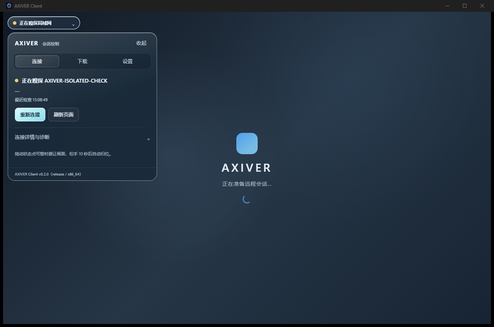
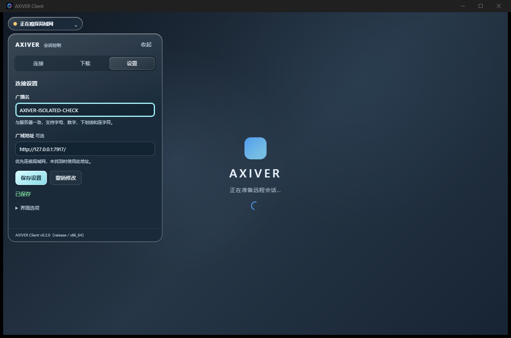

> 此记录对应单窗口首版；后续磨砂、动画及下载模式变更见 [design-qa-v4.md](./design-qa-v4.md)。

# 单窗口界面验收记录 v3

日期：2026-10-25。范围：SNSBox / AXIVER Windows 客户端单窗口整合、玻璃材质、状态点拖动归位。

## 当前结构

一个 `main` 原生窗口承载 `remote`、`session-tool` 和本地 `shell` 子 WebView。状态胶囊和面板共用 `shell`；原独立面板与 `status-dot` 窗口已删除。IPC capability 仅选择 `webviews:["shell"]`，不按共享主窗口授予权限；命令还检查子视图标签和本地来源。

控制面板按需展开为「连接 / 下载 / 设置」，各页高度分别收紧；置顶和立即归位放在设置页「界面选项」。主项目的34px胶囊、轻模糊参数、蓝灰色、轮廓高光和柔和投影得到复用。正文背景提高不透明度，不声称跨原生 WebView 的视频模糊。

## 状态点交互

- 默认在客户区左上角 `(12,12)` 逻辑像素处。
- 拖动阈值5px，采用屏幕坐标差计算，移动限制在客户区内；拖动时收起面板，避免误点击展开。
- 松手后10秒自动归位。再次开始拖动取消旧计时，松手后重新计时；取消/失去指针捕获同样完成清理。
- 提供设置页立即归位，以及状态胶囊聚焦后的 Home 快捷键。
- 窗口移动无需追踪独立 owned 窗口；缩放/DPI变化统一更新子视图与边界。

## 验证方法

复用 `scripts/verify-downloads.mjs`，使用临时EXE副本、SQLite、WebView2 profile和小型HTTP夹具，不读取用户真实登录态。通过WebView2的调试协议发送真实浏览器鼠标/键盘事件，结合原生窗口枚举和 `PrintWindow` 截图确认最终界面，不以进程存活代替交互验证。

原生枚举保留原始窗口详情，单独识别运行库的16×16 `Tao Thread Event Target` 消息窗口，不将其误计为用户面板。

本轮针对性检查：

- `cargo test --offline --locked --lib ui_layout::tests`：最小/普通窗口、边缘/越界位置、展开/收起边界通过。
- `cargo test --offline --locked --test contract_manifest`：5项通过，包括子视图授权、仅一个主窗口创建入口、无远端设置注入及本地IPC桥。
- `node --check ui/shell.js`、`node --check scripts/verify-downloads.mjs`：通过。
- Debug隔离运行确认：默认收起、点击展开、设置页Enter保存、拖动位移且不误开面板、10秒前保持位置/之后归位、远端无法读取配置，连续下载4/4成功。

最终发布版已完成单窗口、设置保存、拖动10秒归位、工具共享Cookie与BroadcastChannel、返回桌面焦点恢复和连续下载4/4验证。运行结果与截图保存在 `../screenshots/single-window-release-final/`。该目录的 `results.json` 记录主窗口数、归位、工具共享会话/BroadcastChannel、焦点恢复及下载结果；失败项不会标记为通过。

## 截图

本轮截图均来自隔离测试实例，背景为等待页或本地测试页面，不代表用户登录后的微信/QQ桌面。

## 交付与边界

便携产物为 `dist/AXIVER-Client.exe`，替换前保留旧EXE；数据库和WebView2 profile沿用现有目录。源码修改前的快照在 `../reference/pre-single-window-20261025/`。

验证不覆盖真实登录态微信/QQ原生拖放、真实中文/日文候选输入、不同显示器的实际DPI切换和长时间会话。IME兼容脚本、服务器容器与认证流程未改动。

交付记录：2026-10-25 15:09 更新 `dist/AXIVER-Client.exe`（5,010,944 字节），回滚文件为 `dist/AXIVER-Client-before-single-window-20261025-150921.exe`。替换时没有运行实例；原数据库大小与修改时间均未变化。测试生成的小文件已由检查脚本逐一核对后清理，临时 profile 目录的递归清理被自动审批策略拒绝，因此保留；结果与截图保留。
