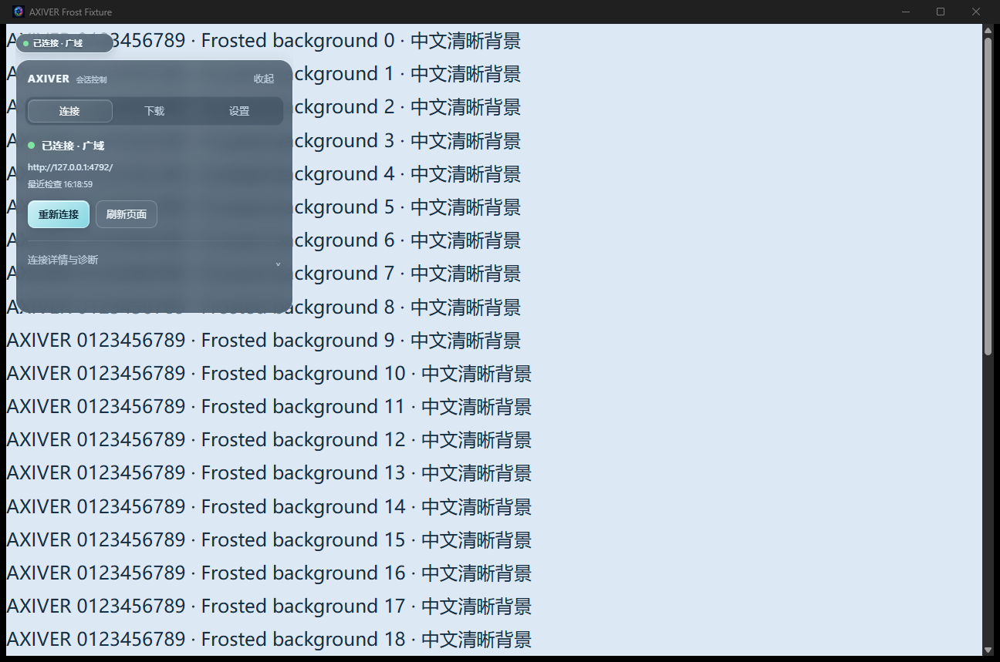
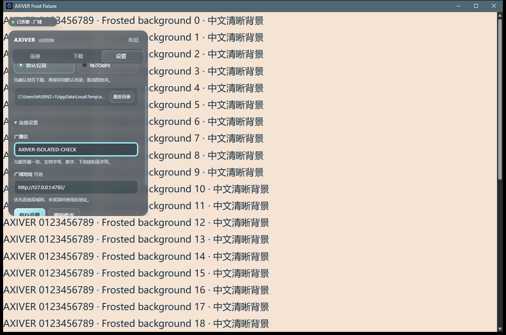
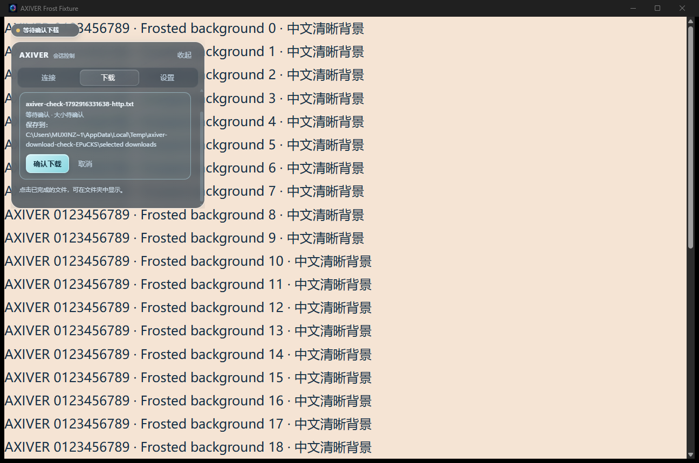

# 磨砂、动画与下载模式验收 v4

日期：2026-10-25。对应本轮用户截图与后续下载模式说明。

## 实现

- 状态胶囊128×26，移除箭头；10秒后以约640ms弹簧轨迹归位，重拖可打断。
- 使用原生 WebView2 CapturePreview 对远程子视图作内存JPEG采样，在本地材质内部裁切并模糊，解决CSS无法直接模糊另一个子WebView的问题。没有屏幕全局捕获，也不持久化采样图片。展开4FPS、收起约1FPS、最小化暂停。
- 控制面板统一为半透明磨砂。开合、页签指示与内容、尺寸、详情、状态文字、按钮、进度均有过渡；系统减少动态效果时停用动画并立即归位。
- 默认位置模式只显示下载确认卡，确认后保存到默认目录；每次询问模式直接弹保存位置框，取消即放弃。队列复用原下载请求，不重放一次性URL。
- 设置页可更改默认目录；模式与目录写入独立的 `download-settings.json`。原有SQLite、连接发现与IME兼容脚本保持原样。
- 最近下载列出本次运行的完成/失败/取消任务；完成项点击后通过Windows Shell选中文件。默认目录的同名文件改名保存，不覆盖既有文件。

## 针对性验证

- 布局边界单测通过；默认目录同名/已预留文件名冲突测试通过，原文件内容未改变。
- manifest5项契约通过：只有本地shell子视图有IPC，仍为一个主窗口，远端无设置注入。
- Debug运行已验证两种模式、原始HTTP请求只发生一次、Blob保存、两处取消均不落盘、目录正确、设置持久化与资源管理器实际选中文件。
- 发布版以 `../screenshots/download-modes-release-final/results.json` 为最终运行证据。执行脚本为 `node scripts/verify-downloads.mjs target/release/axiver-client.exe ../screenshots/download-modes-release-final`。

本轮截图均来自独立profile及本地夹具，不代表真实登录态微信/QQ或WebRTC视频验收。真实输入法、登录态远程画面、跨显示器DPI与长时间性能未在本轮复测。

实现依据：[WebView2 CapturePreview](https://learn.microsoft.com/en-us/microsoft-edge/webview2/reference/win32/icorewebview2)、[DownloadStarting deferral](https://learn.microsoft.com/en-us/microsoft-edge/webview2/reference/win32/icorewebview2downloadstartingeventargs)。

## 最终发布版结果

`download-modes-release-final/results.json` 的全部布尔检查通过：单窗口、128×26无箭头、实际采样更新与12px磨砂、设置保存、10秒前保持位置、弹簧归位、拖动不误开、远端下载IPC拒绝、默认模式仅确认、询问模式直接保存框、两处取消不落盘、模式持久化、HTTP原请求只发生一次、实际目录正确、点击最近项后Explorer选中文件。

归位轨迹采样到19个中间位置，包含轻微越过目标后收敛，最终回到 `(12,12)`，不是瞬间复位。验证不使用哈希校验。

便携EXE已更新；替换前保留旧EXE，替换时没有运行实例，原数据库大小及修改时间不变。
