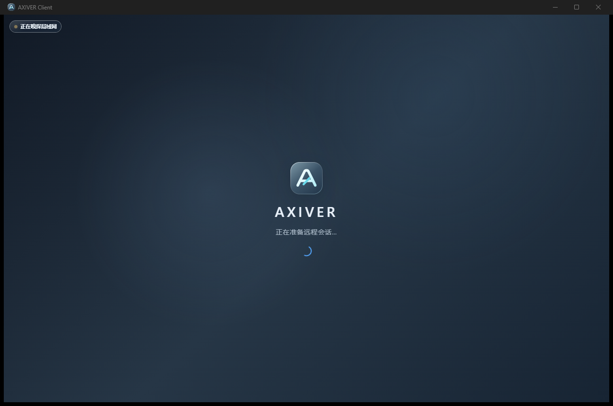
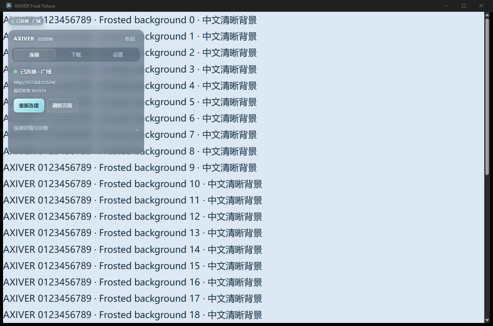
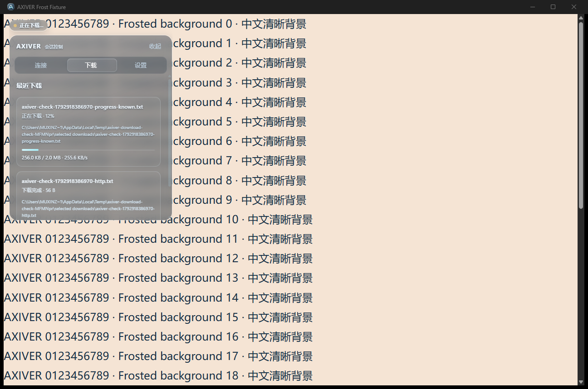
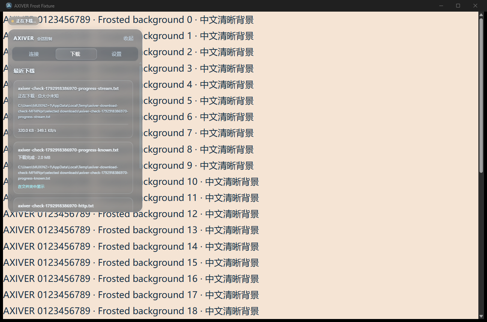

# 下载进度、品牌与 Bar 风格验收 v5

日期：2026-10-25。本轮延续单窗口和两种下载模式，落实用户提供的品牌与状态点标注、主项目 Bar 参考图。

## 实现

- 胶囊固定高度26px，CSS按文字计算固有宽度，ResizeObserver同步原生子视图边界；拖动和弹回也使用实际宽度，避免多余透明区域拦截远程点击。胶囊采样背景从9px降至7.2px模糊，降低20%。
- 材质沿用主项目 `selkies-dock-download.js` 的灰色底色 `rgba(25,42,60,.24)`、白色边缘、160度高光渐变、内高光和轻投影。面板增加阅读所需的底色，保留真实背景采样。文字、按钮、页签、详情与开合动画保持统一。
- 重设计 A 字形与连接斜线标志。`ui/brand-mark.svg` 是唯一设计源；`scripts/build-brand-assets.cjs` 用现有 sharp 渲染各尺寸PNG及多尺寸ICO。等待页直接引用SVG，窗口和托盘显式引用同源PNG，EXE资源使用同源ICO。
- 原生 WebView2 下载事件提供接收量并刷新总大小。速度按约1秒滑动窗口计算，250ms时钟持续更新；等待确认/选择目录的时间不计入速度，停滞后速度归零。
- 已知总大小显示进度条、百分比、已下载/总量与速度；未知总大小显示循环流动条、真实接收量与速度，不伪造百分比。进度条保留DOM节点以免每次更新重启动画，支持读屏进度语义和系统减少动态效果偏好。
- 继续使用原浏览器请求和会话；默认位置仅确认，每次询问直接保存框，取消即放弃；完成记录点击后在资源管理器选中文件。

## 验证与证据

- 针对性单测：速度窗口/停滞归零、默认目录不覆盖既有或已预留文件、不同胶囊宽度下布局边界。
- manifest契约覆盖打包素材、本地IPC边界和单窗口结构。
- 隔离WebView2运行脚本：`node scripts/verify-downloads.mjs target/release/axiver-client.exe ../screenshots/progress-brand-release-final`。使用临时EXE、profile、SQLite和本机HTTP服务，不读取用户登录态；两个2MiB持续流分别提供和省略Content-Length，以真实字节及DOM采样验证百分比、速度和未知大小动画。文件直接比较内容，不使用哈希。
- 同一发布版流程检查10秒前保持位置及平滑弹回、无误点击、两种模式、HTTP及Blob下载、取消不落盘、目录和设置持久化、资源管理器选中文件、单一原生窗口和远端IPC拒绝。

完整结果：`../screenshots/progress-brand-release-final/results.json`。

发布版运行结果全部通过：胶囊实测约96.7×26px，文字变短后同步收缩；弹回采到21个中间位置并回到(12,12)。两个持续下载分别采到19/18组实时进度，已知大小百分比和未知大小流动动画都正确。

另发现Windows EXE资源构建未监听图标文件，导致原生窗口虽已更新、EXE资源仍缓存旧图标。`build.rs` 已增加 `rerun-if-changed=icons` 并重建资源；最终EXE直接提取出的图标与同源PNG的752个不透明像素全部一致，结果见 `brand-resource.json`，没有使用哈希校验。此次资源重建未改变已完成运行验收的业务代码与前端内容。

最终便携版替换信息及数据库大小/修改时间保持不变的记录见 `delivery.json`；替换时未有运行中的便携实例，并保留旧EXE用于回滚。

上述为隔离Windows原生运行验证。真实登录后的微信/QQ触发、多显示器DPI和长时间远程视频性能不在本轮验收范围内。原有SQLite和登录profile保持不变。
